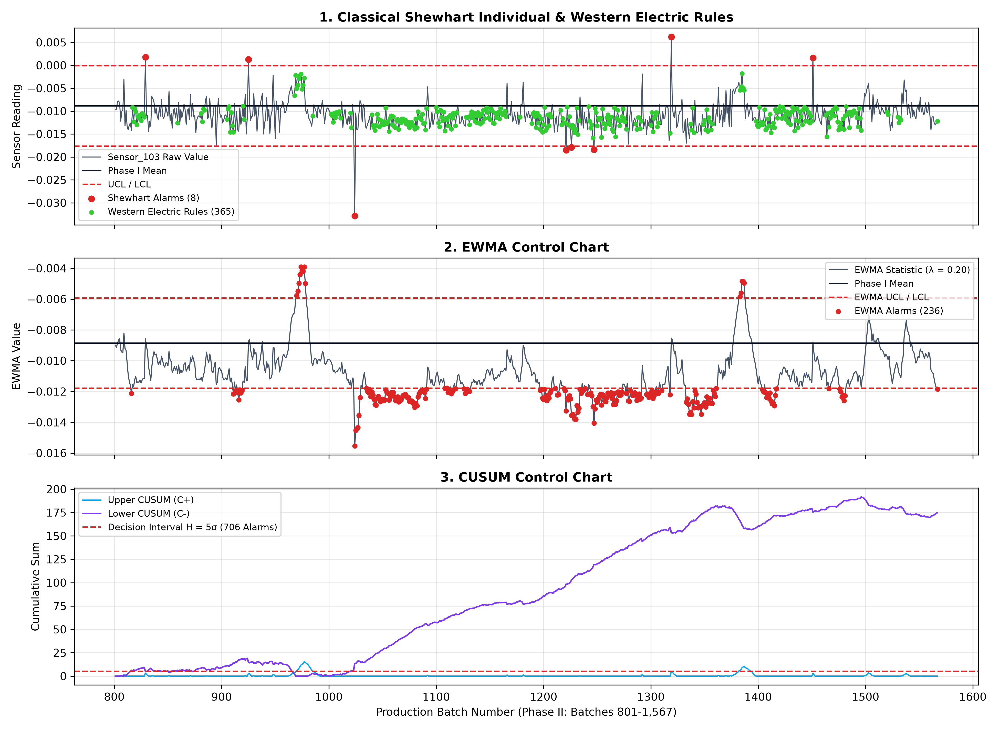
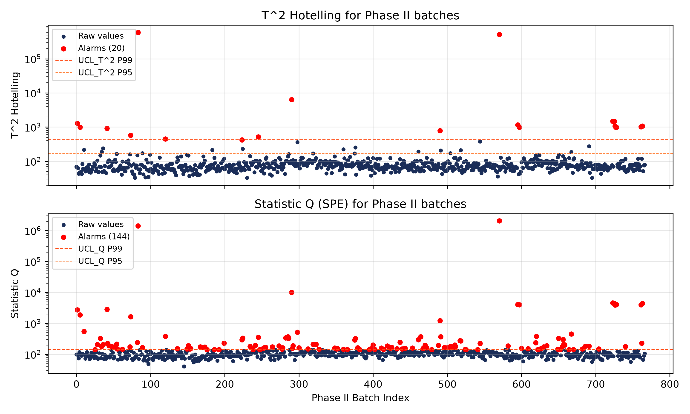
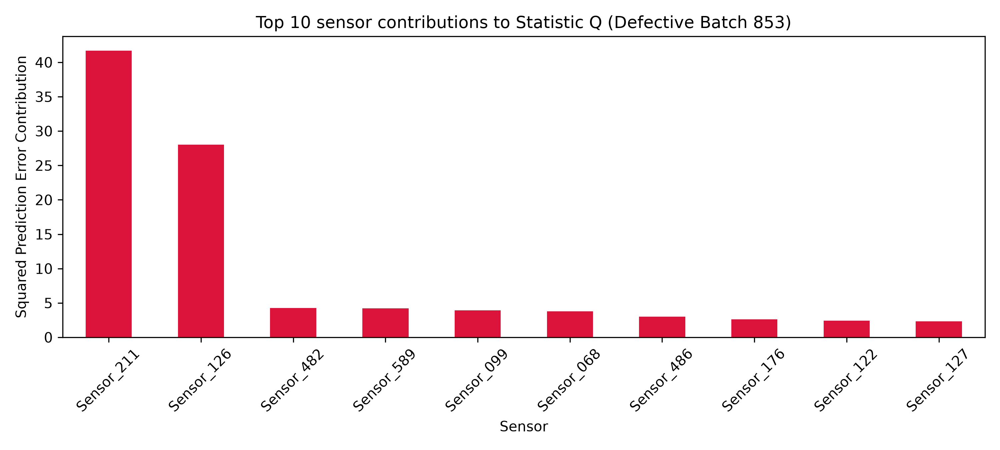
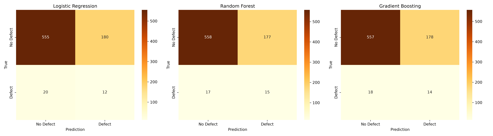
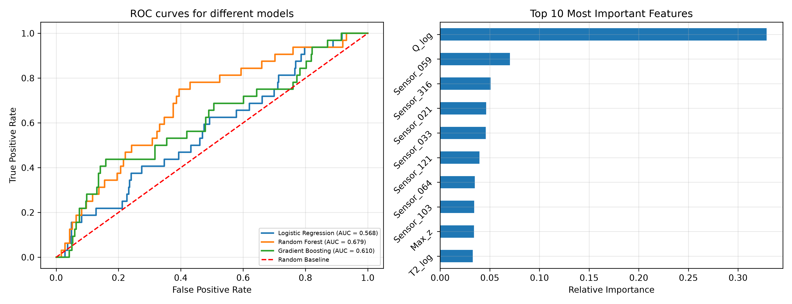

# Multivariate Statistical Process Control (MSPC) and Quality Engineering

<b>🇬🇧 Executive Summary (English)</b>

 
This project develops an end-to-end Multivariate Statistical Process Control (MSPC), process capability, and defect prediction system for semiconductor manufacturing using the real UCI SECOM dataset (1,567 production batches and 590 physical sensors):
<ul>
  <li><b>Statistical Sensor Audit & Phase I/II Split:</b> Chronologically separated the production timeline into Phase I calibration (800 batches; 728 <code>In-Control</code>) and Phase II online monitoring (767 batches; 32 defective). Audited and filtered out 276 corrupted (>40% missing), zero-variance, and collinear (<code>|r| > 0.98</code>) channels strictly on Phase I In-Control data, retaining 314 informative sensors without data leakage.</li>
  <li><b>Univariate SPC & Non-Parametric Bootstrap Capability:</b> Compared memoryless charts (Shewhart 3&sigma; and Western Electric run rules) against memory-based charts (EWMA and Tabular CUSUM). Demonstrated how memory-based charts capture sustained machine decalibrations invisible to Shewhart (e.g., <code>Sensor_103</code> with a <code>-0.70&sigma;</code> drift triggered only 8 Shewhart alarms vs. 236 EWMA and 706 CUSUM alarms), and computed 1,000-iteration non-parametric Bootstrap 95% CIs for $C_p$, $C_{pk}$, and $P_{pk}$ to account for heavy-tailed non-Gaussian distributions.</li>
  <li><b>Multivariate SPC (PCA, Hotelling's $T^2$ & $Q$ / SPE):</b> Compressed the 314-sensor space into $k = 87$ Principal Components (80% explained variance) to monitor all channels simultaneously through two charts: Hotelling's $T^2$ (19 Phase II alarms within the PCA subspace) and the $Q$ statistic / SPE (108 alarms outside the PCA subspace). Implemented automated root-cause Sensor Contribution Plots that immediately isolate the exact physical channels driving an anomaly (e.g., <code>Sensor_211</code> and <code>Sensor_126</code> in defective Batch 853).</li>
  <li><b>Machine Learning Defect Prediction with SPC Feature Engineering:</b> Embedded the engineered MSPC statistics ($\ln(1 + T^2)$, $\ln(1 + Q)$, and $\max|Z|$) alongside the Top 25 defect-correlated sensors into supervised classifiers (Logistic Regression, Random Forest, and Gradient Boosting). Random Forest achieved the best out-of-time Phase II discrimination (ROC-AUC = 0.679, Recall = 46.9% at the 75th percentile risk cutoff), with all three engineered SPC features ranking in the Top 10 predictors and $\ln(1 + Q)$ standing out as the #1 most important variable in the entire model.</li>
</ul>

<b>🇪🇸 Resumen Ejecutivo (Castellano)</b>

 
Este proyecto desarrolla un sistema integral de Control Estadístico de Procesos Multivariante (MSPC), análisis de capacidad e inteligencia predictiva de defectos en fabricación de semiconductores utilizando el dataset real UCI SECOM< (1.567 lotes de producción y 590 sensores físicos):
<ul>
  <li><b>Auditoría Estadística de Sensores y Separación Fase I/II:</b> División cronológica en Fase I de calibración (800 lotes; 728 bajo control <code>In-Control</code>) y Fase II de monitorización en línea (767 lotes; 32 defectuosos). Limpieza de 276 sensores corruptos (>40% nulos), constantes (varianza nula) y colineales (<code>|r| > 0.98</code>) calibrada exclusivamente sobre los lotes sanos de Fase I, conservando 314 sensores válidos< sin fuga de datos (<i>data leakage</i>).</li>
  <li><b>SPC Univariante y Capacidad con Bootstrap No Paramétrico:</b> Comparativa de gráficos sin memoria (Shewhart 3&sigma; y reglas de Western Electric) frente a gráficos con memoria (EWMA y CUSUM Tabular), demostrando cómo EWMA (236 alarmas) y CUSUM (706 alarmas) detectan descalibraciones sostenidas invisibles para Shewhart (8 alarmas en <code>Sensor_103</code> ante una deriva de <code>-0.70&sigma;</code>). Estimación de índices $C_p$, $C_{pk}$ y $P_{pk}$ mediante intervalos de confianza Bootstrap al 95% (1.000 remuestreos) ante la falta de normalidad.</li>
  <li><b>SPC Multivariante (PCA, $T^2$ de Hotelling y Estadístico $Q$ / SPE):</b> Reducción de los 314 sensores a $k = 87$ Componentes Principales (80% de varianza explicada) para monitorizar toda la planta en dos únicos gráficos: $T^2$ de Hotelling (19 alarmas en Fase II dentro del modelo PCA) y el estadístico $Q$ / SPE (108 alarmas por rotura de correlación fuera del modelo). Diagnóstico automático de causa raíz mediante Gráficos de Contribución (identificando a <code>Sensor_211</code> y <code>Sensor_126</code> como responsables del fallo en el Lote 853).</li>
  <li><b>Predicción de Defectos con Machine Learning e Ingeniería de Variables SPC:</b> Integración de los estadísticos MSPC ($\ln(1 + T^2)$, $\ln(1 + Q)$ y $\max|Z|$) junto a los 25 sensores más correlacionados en modelos supervisados (Regresión Logística, Random Forest y Gradient Boosting). Random Forest logra la mejor capacidad predictiva en Fase II (ROC-AUC = 0,679 y Recall = 46,9% en el percentil 75 de riesgo), situando a las tres variables SPC en el Top 10 de importancia y a $\ln(1 + Q)$ como la variable #1 más determinante del modelo.</li>
</ul>

<b>Laburpena (Euskara)</b>

 
Proiektu honek Aldagai Anitzeko Prozesuen Kontrol Estatistikoko (MSPC), gaitasun-analisiko eta akatsen iragarpeneko sistema integral bat garatzen du fabrikaziorako, UCI SECOM datu-multzo erreal bat erabiliz (1.567 ekoizpen-lote eta 590 sentsore fisiko):
<ul>
  <li><b>Sentsoreen Ikuskaritza Estatistikoa eta I/II Faseen Banaketa:</b> Denbora-lerroaren banaketa kronologikoa kalibrazioko I. Fasean (800 lote; 728 kontrolpean edo <code>In-Control</code>) eta online monitorizazioko II. Fasean (767 lote; 32 akastun). I. Faseko lote osasuntsuetan soilik oinarrituta, hondatutako (>% 40 balio huts), bariantza nuluko eta kolinealitate muturreko (<code>|r| > 0.98</code>) 276 sentsore ezabatu dira, 314 sentsore baliagarri mantenduz (<i>data leakage</i>) gabe.</li>
  <li><b>Aldagai Bakarreko SPC eta Bootstrap Ez-Parametrikoko Gaitasuna:</b> Memoriarik gabeko grafikoen (Shewhart 3&sigma; eta Western Electric arauak) eta memoriadun grafikoen (EWMA eta CUSUM Taularra) arteko konparazioa, EWMAk (236 alarma) eta CUSUMek (706 alarma) Shewhart-entzat ikusezinak diren desdoitze iraunkorrak nola harrapatzen dituzten frogatuz (8 alarma soilik <code>Sensor_103</code> sentsorean <code>-0.70&sigma;</code>-ko desbideratze baten aurrean). Banaketa ez-normalen aurrean, $C_p$, $C_{pk}$ eta $P_{pk}$ gaitasun-indizeak % 95eko Bootstrap konfiantza-tarteekin (1.000 birlaginketa) kalkulatu dira.</li>
  <li><b>Aldagai Anitzeko SPC (PCA, Hotelling-en $T^2$ eta $Q$ / SPE Estatistikoa):</b> 314 sentsoreak $k = 87$ Osagai Nagusitan (azaldutako bariantzaren % 80) trinkotzea, fabrika osoa bi grafikoren bidez monitorizatzeko: Hotelling-en $T^2$ (19 alarma II. Fasean PCA ereduaren barruan) eta $Q$ / SPE estatistikoa (108 alarma PCA eredutik kanpoko korrelazio-hausturagatik). Erroko kausaren diagnostiko automatikoa Ekarpen Grafikoen bidez (853. Lote akastunean <code>Sensor_211</code> eta <code>Sensor_126</code> errudun nagusi gisa isolatuz).</li>
  <li><b>Akatsen Iragarpena Machine Learning eta SPC Aldagaien Ingeniaritzarekin:</b> MSPC estatistikoak ($\ln(1 + T^2)$, $\ln(1 + Q)$ eta $\max|Z|$) eta akatsekin korrelazio handiena duten 25 sentsoreak ikaskuntza gainbegiratuko ereduetan (Erregresio Logistikoa, Random Forest eta Gradient Boosting) txertatzea. Random Forest ereduak lortu du II. Faseko emaitzarik onena (ROC-AUC = 0,679 eta Recall = % 46,9 arriskuaren 75. pertzentilean), sortutako hiru SPC aldagaiak 10 garrantzitsuenen artean kokatuz eta $\ln(1 + Q)$ eredu osoko #1 aldagai erabakigarriena bihurtuz.</li>
</ul>

---

## 1. Aims and goals
Most modern factories rely on hundreds of physical sensors to verify the quality of the final product, as manufacturing lines are highly automated. Variables such as temperature, pressure, and voltage are continuously measured in every production batch.

However, automating quality verification also introduces statistical challenges. Monitoring such a complex process requires a large number of sensors, and checking each sensor individually with traditional control charts generates a high rate of false alarms (making it almost impossible to keep the entire plant under control). Furthermore, individual charts cannot detect when the physical correlation between several variables breaks down.

Therefore, the main goal of this project is to build a complete Statistical Process Control system using real manufacturing data in order to:
1. Statistically audit and filter out corrupted, constant, and redundant sensors.
2. Compare classic control charts against memory-based control charts, and evaluate process capability using non-parametric Bootstrap.
3. Monitor the entire process simultaneously in a multivariate way using PCA, Hotelling's $T^2$, and the $Q$ (SPE) statistic, identifying which specific sensors trigger each alarm.
4. Predict which production batches will be defective.

## 2. Dataset and Statistical Sensor Audit
The dataset used in this project comes from *Kaggle* and is called [UCI SECOM](https://www.kaggle.com/datasets/paresh2047/uci-semcom). In this [raw dataset](data/uci-secom.csv), there are 1,567 production batches recorded chronologically between January and December 2008, with 590 sensors and a binary target variable indicating whether each batch passed or failed quality inspection. Across the dataset, 104 batches (6.64%) are defective, while the remaining 1,463 batches are in control. All the data cleaning and statistical auditing steps are implemented in this [Jupyter Notebook](notebooks/eda_and_cleaning.ipynb).

### 2.1. Phase I and Phase II Separation
After loading and sorting the dataset chronologically, the first step is to split the timeline into two phases: a Calibration Phase (Phase I) and an Online Monitoring Phase (Phase II).

We assign the first 800 batches to Phase I to calibrate the system. Within this period, 728 batches are non-defective (`In-Control`), and we use exclusively these 728 batches to estimate the baseline medians, standard deviations, and correlations in order to avoid data leakage.

The remaining 767 batches, with 32 defective batches, form Phase II, which we use to simulate real-time monitoring on the production line.

### 2.2. Statistical Sensor Audit
In a real industrial environment with hundreds of sensors, many channels fail, remain turned off, or record redundant measurements. Therefore, we apply three statistical filters computed strictly on our Phase I In-Control baseline:
1. Remove sensors with more than 40% missing values.
2. Remove constant sensors with zero variance, as they provide no information and would cause division-by-zero errors during standardization.
3. Remove sensors with extreme collinearity to prevent the covariance matrix from becoming singular.

Table 1 summarises the number of sensors removed at each step of the audit:

**Table 1. Summary of the Phase I statistical sensor audit.**
| Step                                        |   Sensors_Removed |   Sensors_Remaining | Reason                                                   |
|:--------------------------------------------|------------------:|--------------------:|:---------------------------------------------------------|
| 1. Initial Raw Sensors                      |                 0 |                 590 | Raw SECOM telemetry input                                |
| 2. Missing Data Filter (>40% NaN)           |                28 |                 562 | Unreliable / sparse sampling in Phase I                  |
| 3. Zero-Variance Filter (std < 1e-6)        |               122 |                 440 | Constant / turned-off sensors                            |
| 4. Extreme Collinearity Filter (|r| > 0.98) |               126 |                 314 | Redundant channels (prevents singular covariance matrix) |

As shown in the table, we removed 28 sensors in the first filter, 122 in the second, and 126 in the third, reducing the original 590 channels to 314 informative sensors.

Finally, we retain these same 314 sensors for Phase II, impute any remaining missing observations using the Phase I In-Control medians (a robust estimator against outliers), and save the clean dataset in [`data/secom_cleaned.csv`](data/secom_cleaned.csv).

## 3. Univariate Statistical Process Control and Process Capability
In this section, we analyse the individual behaviour of the most critical sensors in this [Jupyter Notebook](notebooks/univariate_spc.ipynb). We evaluate each sensor both batch by batch and across sequences of consecutive batches to detect systematic process drift.

First, we select the 5 sensors most correlated with defective batches in Phase I: `Sensor_348`, `Sensor_059`, `Sensor_021`, `Sensor_103`, and `Sensor_510`. We also use `Sensor_103` as our main case study to visualise how each control chart behaves during Phase II online monitoring.

### 3.1. Memoryless vs. Memory-Based Control Charts
Using the baseline mean and standard deviation calibrated exclusively on the Phase I `In-Control` batches, we compare four methods for triggering quality alarms in Phase II (identifying batches where a sensor deviates from its normal operating range due to machine decalibration or process drift):

#### 1. Shewhart Individual ($I$) Chart
This is the classic memoryless control chart. It only evaluates the current batch and is designed to detect isolated extreme peaks outside the control limits ($\mu_0 \pm 3\sigma_0$). When the process is stable, it is statistically very rare for an observation to fall outside these limits, so any point beyond $\pm 3\sigma_0$ indicates an acute anomaly. However, because it has no memory of previous batches, it is insensitive to small, sustained shifts in the process mean.

#### 2. Western Electric Rules
To overcome the lack of memory in the standard Shewhart chart, the Western Electric rules trigger an alarm whenever non-random runs or streaks appear across consecutive batches. In addition to the $\pm 3\sigma_0$ limit, the most common rules are:
- **2 out of 3 consecutive batches** fall beyond $\mu_0 \pm 2\sigma_0$ on the same side of the mean.
- **8 consecutive batches** fall on the same side of the mean ($\mu_0$).

With these rules, there is no need to wait for an extreme spike to see that something is wrong: a persistent run above or below the centerline reveals that the process mean has shifted.

#### 3. EWMA (Exponentially Weighted Moving Average) Control Chart
Instead of inspecting raw sensor values in isolation, the EWMA chart builds a statistic with memory by computing an exponentially weighted moving average. It combines the current observation with the past history of the process to smooth out random noise and detect small, persistent deviations.

The weighting parameter $\lambda \in (0, 1]$ (here $\lambda = 0.20$) controls the balance between the current batch and the historical average:

$$
Z_i = \lambda X_i + (1 - \lambda) Z_{i-1},
$$

where $Z_i$ is the EWMA value at batch $i$ (initialised at $Z_0 = \mu_0$), with control limits set at $\mu_0 \pm 3\sigma_0 \sqrt{\frac{\lambda}{2 - \lambda}}$.

#### 4. Tabular CUSUM (Cumulative Sum) Chart
The CUSUM chart accumulates deviations exceeding a reference slack $K$ (typically $K = 0.5\sigma_0$) batch after batch in two separate accumulators: $C^+$ for upward shifts and $C^-$ for downward shifts, triggering an alarm whenever either accumulator exceeds the decision threshold $H$ (set to $H = 5\sigma_0$):
$$
C_i^+ = \max(0, C_{i-1}^+ + z_i - K), \qquad C_i^- = \max(0, C_{i-1}^- - z_i - K)
$$
where $z_i = \frac{X_i - \mu_0}{\sigma_0}$ is the standardized sensor reading.

If the process is operating properly around $\mu_0$, small random fluctuations cancel each other out and both accumulators stay near zero. However, if a machine becomes slightly decalibrated, a shift that remains invisible on a Shewhart chart steadily adds up across consecutive batches in $C^+$ or $C^-$ until it crosses $H$.

#### 3.1.1. Phase II Alarm Comparison and Visual Analysis
Table 2 compares the Phase II mean shift (in units of $\sigma_0$) and the number of alarms detected by each control chart across the 5 critical sensors:

**Table 2. Phase II alarm comparison across the top 5 critical sensors.**
| Sensor     |   Phase_II_Mean_Shift_Sigma |   Shewhart_Alarms |   Western_Electric_Alarms |   EWMA_Alarms |   CUSUM_Alarms |
|:-----------|----------------------------:|------------------:|--------------------------:|--------------:|---------------:|
| Sensor_348 |                       -0.28 |                 7 |                       130 |             3 |              5 |
| Sensor_059 |                       -0.37 |                 2 |                       354 |             6 |            219 |
| Sensor_021 |                        0.13 |                 5 |                       121 |             9 |             40 |
| Sensor_103 |                       -0.70 |                 8 |                       365 |           236 |            706 |
| Sensor_510 |                       -0.31 |                10 |                       241 |            19 |            266 |

`Sensor_103` stands out as the most affected channel, suffering a sustained downward mean shift of $-0.70\sigma_0$ in Phase II. The classic Shewhart chart only detects **8 alarms** out of 767 batches, giving the false impression that the sensor is mostly in control. Once we incorporate run rules with Western Electric, the number of alarms jumps to 365, showing that the process is not suffering from isolated spikes, but rather from a persistent decalibration. Similarly, while the other four sensors show moderate EWMA alarm counts, `Sensor_103` triggers 236 EWMA alarms and 706 CUSUM alarms, confirming a continuous downward drift.

To see why this happens, Figure 1 compares the four methods on `Sensor_103` across all Phase II batches:

As shown in Figure 1:
1. **Top panel (Shewhart & Western Electric):** Almost all raw observations in Phase II lie between the Phase I mean and the lower control limit (`LCL`). Because very few individual points cross $-3\sigma_0$, Shewhart only flags 8 extreme peaks (red dots). In contrast, the Western Electric rules (green dots) immediately detect the long runs below the centerline, flagging 365 batches.
2. **Middle panel (EWMA):** By smoothing out batch-to-batch noise ($\lambda = 0.20$), the EWMA curve stays consistently below the Phase I mean and repeatedly crosses the lower control limit (236 red alarm points), clearly tracking the downward shift.
3. **Bottom panel (Tabular CUSUM):** Because almost all observations are below the mean, the negative accumulator $C^-$ (purple curve) climbs continuously past the decision threshold $H$, accounting for 97.9% of all CUSUM alarms (691 out of 706 alarms in $C^-$), whereas the positive accumulator $C^+$ (blue curve) remains flat near zero.

### 3.2. Process Capability Indices and Non-Parametric Bootstrap
While control charts evaluate whether a process is statistically stable over time, Process Capability Indices measure whether the process is actually capable of producing batches within engineering tolerance limits (the Lower and Upper Specification Limits, $\text{LSL}$ and $\text{USL}$). Following the Six-Sigma industrial design benchmark, we define the specification limits from our Phase I `In-Control` baseline as $\text{LSL} = \mu_0 - 4\sigma_0$ and $\text{USL} = \mu_0 + 4\sigma_0$.

We evaluate two pairs of capability indices:
- **Short-term capability ($C_p$ and $C_{pk}$):** Uses the batch-to-batch dispersion estimated via the average moving range between consecutive batches ($\sigma_{\text{within}} = \frac{\overline{MR}}{1.128}$). $C_p$ measures the potential capability (whether the natural process spread fits inside the tolerance window), whereas $C_{pk}$ measures the actual capability taking process centering into account:
$$
C_p = \frac{\text{USL} - \text{LSL}}{6\sigma_{\text{within}}}, \qquad C_{pk} = \min\left(\frac{\text{USL} - \mu}{3\sigma_{\text{within}}}, \frac{\mu - \text{LSL}}{3\sigma_{\text{within}}}\right)
$$
- **Overall long-term performance ($P_p$ and $P_{pk}$):** Uses the overall sample standard deviation ($\sigma_{\text{overall}} = s$) across the entire phase to capture the real long-term performance including process drift:
$$
P_p = \frac{\text{USL} - \text{LSL}}{6\sigma_{\text{overall}}}, \qquad P_{pk} = \min\left(\frac{\text{USL} - \mu}{3\sigma_{\text{overall}}}, \frac{\mu - \text{LSL}}{3\sigma_{\text{overall}}}\right)
$$

Furthermore, because real manufacturing telemetry is not perfectly Gaussian and point estimates carry sample uncertainty, we apply non-parametric Bootstrap resampling ($B = 2,000$ resamples with replacement) on the Phase I baseline to obtain the 95% confidence interval for $C_{pk}$.

Table 3 summarises the Phase I capability indices, their 95% Bootstrap confidence intervals, and the resulting Phase II long-term performance ($P_{pk}$):

**Table 3. Process capability indices and 95% Bootstrap confidence intervals.**
| Sensor     |   Phase_I_Cp |   Phase_I_Cpk | Bootstrap_95_CI   |   Phase_I_Ppk |   Phase_II_Ppk |
|:-----------|-------------:|--------------:|:------------------|--------------:|---------------:|
| Sensor_348 |        1.823 |         1.823 | [1.362, 1.659]    |         1.333 |          1.766 |
| Sensor_059 |        2.015 |         2.015 | [1.325, 1.583]    |         1.333 |          1.618 |
| Sensor_021 |        1.786 |         1.786 | [1.412, 1.754]    |         1.333 |          1.752 |
| Sensor_103 |        1.972 |         1.972 | [1.271, 1.494]    |         1.333 |          1.148 |
| Sensor_510 |        1.930 |         1.930 | [1.493, 1.883]    |         1.333 |          1.440 |

From Table 3, we can draw three key quality engineering conclusions:
1. **Perfect centering in Phase I:** Across all 5 sensors, $C_p$ and $C_{pk}$ are identical in Phase I, proving that the baseline process is perfectly centered between $\text{LSL}$ and $\text{USL}$, and the overall performance meets the industry safety standard ($P_{pk} = 1.333 \ge 1.33$).
2. **Impact of the Phase II mean shift on `Sensor_103`:** In Phase II, the short-term potential capability of `Sensor_103` barely changes ($C_p$ goes from $1.972$ to $1.855$), meaning its local batch-to-batch noise has not increased. However, because the mean shifted downward by $-0.70\sigma_0$ toward the lower specification limit, its actual capability drops to $C_{pk} = 1.532$ and its overall long-term performance falls to **$P_{pk} = 1.148$**.
3. **Crossing the $1.33$ industrial threshold:** Dropping from $P_{pk} = 1.333$ to $P_{pk} = 1.148$ places `Sensor_103` below the $1.33$ capability threshold required in semiconductor manufacturing, multiplying the expected defect rate almost fivefold (from $\approx 63\text{ PPM}$ to nearly $300\text{ PPM}$).

In summary, univariate memory-based charts (EWMA and CUSUM) and capability analysis effectively diagnose persistent drift in an individual sensor. However, monitoring all 314 sensors one by one is unfeasible in a real plant and cannot detect when the physical correlation between multiple sensors breaks down—which motivates our transition to Multivariate Statistical Process Control (MSPC) in the next section.

## 4. Multivariate Statistical Process Control (MSPC)
In Section 3, we saw how to monitor a single sensor individually, but in our cleaned dataset we have 314 sensors operating simultaneously. Analysing all 314 channels one by one is unfeasible and would produce an excessive number of false alarms. Instead, we can reduce the dimensionality of the problem to monitor the entire production line at once using Principal Component Analysis (PCA), as implemented in this [Jupyter Notebook](notebooks/multivariate_spc.ipynb).

### 4.1. Dimensionality Reduction with Principal Component Analysis (PCA)
Because our 314 sensors measure different physical variables in different units and scales, the first mandatory step is standardization so that every sensor has a mean of $0$ and a variance of $1$.

To prevent data leakage, we compute the baseline mean and standard deviation exclusively on the `In-Control` batches of Phase I (`fit_transform`), and we use those exact same parameters to scale the Phase II batches (`transform`).

Once the data are standardized, we apply Principal Component Analysis (PCA). PCA finds the main orthogonal directions in which the data vary and compresses all 314 sensors into a much smaller number of uncorrelated principal components. Fitting PCA on the Phase I `In-Control` batches reveals that we need $k = 87$ principal components to capture 80% of the total process variance. Using this model, we then project the Phase II batches onto those same $k = 87$ components. Although 87 components may seem large compared to small textbook datasets, starting from more than 300 distinct physical sensors and reducing them to fewer than a third of the original variables (a 72.3% dimensionality reduction) provides a compact and effective representation of the plant.

### 4.2. Hotelling's $T^2$ and $Q$ (SPE) Control Charts
Instead of inspecting 314 separate charts, we summarise the state of the plant in every batch $i$ using two complementary multivariate statistics:

#### 1. Hotelling's $T^2$
This statistic summarises in a single number how far batch $i$ lies from the normal operating center within the $k$ principal components. Since each principal component $j$ has its own Phase I variance $\lambda_j$, we divide the squared score ($t_{i,j}^2$) of each component by its variance and sum them all:
$$
T_i^2 = \sum_{j=1}^{k} \frac{t_{i,j}^2}{\lambda_j}
$$
Hotelling's $T^2$ monitors what happens inside the PCA model, that is, it detects whether the principal components suffer unusually large shifts in magnitude while still following their normal correlation structure.

#### 2. Statistic $Q$ (Squared Prediction Error, SPE)
This statistic monitors what happens outside the PCA model by measuring the residual error when reconstructing the 314 sensors from the $k$ principal components. It answers what happens when a sensor fails or when the physical relationship between two sensors breaks in a new direction not captured by the $k$ principal components:
$$
Q_i = \sum_{m=1}^{314} \left(X_{i,m} - \hat{X}_{i,m}\right)^2
$$
where $\hat{X}_{i,m}$ is the reconstructed value of sensor $m$ obtained via the inverse PCA transformation (`pca.inverse_transform`) from the $k = 87$ components.

#### Upper Control Limits (`UCL`) and Phase II Results
To detect out-of-control batches in Phase II, we define the Upper Control Limits (`UCL`) for $T^2$ and $Q$ using the 95th and 99th empirical percentiles of the Phase I `In-Control` batches. An alarm in Hotelling's $T^2$ indicates that the sensors are still moving in a coordinated way, but with an excessive amplitude. Conversely, an alarm in the $Q$ statistic indicates that the PCA model can no longer reconstruct that batch accurately because the normal correlation structure between sensors has broken down.

Figure 2 shows both control charts across all Phase II batches (plotted on a logarithmic scale so that extreme excursions do not compress the baseline):

At the 99% confidence level (`P99`), Phase II triggers 19 alarms in Hotelling's $T^2$ and 108 alarms in the $Q$ statistic (108 combined alarms in total, since every batch that exceeds the $T^2$ limit also exceeds the $Q$ limit). The fact that $Q$ triggers far more alarms than $T^2$ demonstrates that most anomalies in Phase II are caused by breakdowns in sensor-to-sensor correlations that deviate from the Phase I operating patterns.

### 4.3. Root-Cause Diagnosis: Sensor Contribution Plots
In Section 3, when an individual chart triggered an alarm, we immediately knew which sensor was responsible. In a multivariate chart, however, a single point on $T^2$ or $Q$ summarises all 314 sensors at once. Therefore, once an alarm is triggered, we need a diagnostic tool to identify which specific sensors are responsible. We achieve this by decomposing the $Q_i$ statistic into the individual squared prediction error of each sensor:
$$
\text{Contribution}_{i,m} = \left(X_{i,m} - \hat{X}_{i,m}\right)^2
$$
The sensors with the largest contributions are the ones that deviated most severely from the correlation structure of the PCA model in that batch.

To illustrate this root-cause diagnosis, we filter the Phase II batches that are actually defective (`Defect == 1`) and also triggered a multivariate alarm (6 defective batches at the `P99` limit, and 11 at `P95`). Taking the first detected defective batch (Batch 853, index 52 of Phase II), Figure 3 displays the Top 10 sensors with the highest contributions to $Q$:

As shown in Figure 3, the anomaly is overwhelmingly driven by `Sensor_211` (contribution $\approx 42.6$) and `Sensor_126` (contribution $\approx 29.3$), which concentrate almost the entire reconstruction error far above the remaining channels ($\le 4.1$), pointing the process engineer directly to the physical sensors that caused the fault.

In conclusion, Multivariate SPC with PCA, Hotelling's $T^2$, and the $Q$ statistic allows us to monitor all 314 sensors in real time using just two charts and immediately isolate the root-cause sensors behind any alarm. Building on these statistical features, the final step of our project in Section 5 is to train a Machine Learning defect prediction model to classify which production batches are most likely to fail quality inspection.

## 5. Defect Prediction with Machine Learning and SPC Feature Engineering
Until now, our focus has been on Statistical Process Control (SPC): calibrating what a healthy (`In-Control`) batch looks like and triggering an alarm whenever a new observation exceeds the control limits. In this final section, we take a step further and train supervised Machine Learning models on Phase I data to predict which Phase II production batches will fail quality inspection. The full implementation can be found in this [Jupyter Notebook](notebooks/defect_prediction.ipynb).

Rather than training our classifiers solely on raw sensor readings, we incorporate SPC Feature Engineering derived from our previous analyses. Specifically, we engineer three global statistical indicators for every batch:
- **Hotelling's $T^2$** ($\ln(1 + T^2)$): measuring the multivariate deviation within the PCA subspace.
- **$Q$ Statistic / SPE** ($\ln(1 + Q)$): measuring the squared reconstruction error outside the PCA subspace.
- **Maximum Univariate Peak** ($\max_m |Z_{i,m}|$): capturing the largest single-sensor deviation in standard deviations.

As in Section 4, we calibrate the `StandardScaler` and the PCA projection ($k = 87$ principal components, retaining 80% of variance) strictly on the 728 `In-Control` batches from Phase I. Because both Hotelling's $T^2$ and the $Q$ statistic can reach extremely large values during severe process excursions (as seen in Figure 2), we apply a logarithmic transformation $\ln(1 + x)$ to compress extreme outliers while safely handling values close to zero without numerical errors.

Given that the cleaned dataset contains more than 300 sensors (314 channels) for only 800 Phase I batches, feeding all variables directly into a classifier would lead to severe overfitting. To prevent this, we select the Top 25 sensors most strongly correlated with defects in Phase I and combine them with our 3 engineered SPC features (`T2_log`, `Q_log`, and `Max_z`), resulting in a compact 28-feature matrix. We use Phase I ($N_1 = 800$) as our training set and Phase II ($N_2 = 767$) as our out-of-time test set.

### 5.1. Model Comparison and Class Imbalance Handling
Once the feature matrices are scaled using Phase I parameters, we train and compare three distinct classification families:
- Logistic Regression
- Random Forest
- Gradient Boosting

Because defective batches represent a small minority of production (9.0% in Phase I and only 4.17% in Phase II), a naive classifier could achieve over 95% accuracy simply by predicting every batch as healthy (`No Defect`). To overcome this severe class imbalance, we apply balanced class weights (`class_weight='balanced'`) during training.

#### Logistic Regression
This linear classifier assigns a weight to each input variable and combines them through a logistic function to estimate a defect probability between 0 and 1. While it is fast, simple, and highly interpretable, it struggles to capture complex, non-linear interactions among sensors. Its hyperparameter $C$ controls the inverse of regularization strength; we set `$C = 0.1$` (strong L2 regularization) to penalize disproportionately large weights on noisy or collinear sensors.

#### Random Forest
Unlike Logistic Regression, Random Forest is an ensemble method that builds multiple decision trees in parallel on bootstrap samples of the training data and averages their predictions. It naturally captures non-linear relationships and higher-order interactions between sensors. However, it is less directly interpretable than a linear model and requires more computational resources. We set `n_estimators = 300` to build 300 independent trees in parallel for stable probability estimates, while restricting tree complexity with a maximum depth of 5 levels (`max_depth = 5`) and requiring at least 5 batches per terminal leaf (`min_samples_leaf = 5`) so individual trees do not memorize specific noisy batches.

#### Gradient Boosting
Gradient Boosting also relies on decision trees, but instead of training them independently in parallel, it builds them sequentially: each new tree is trained to correct the residual errors made by the previous ensemble. While this sequential boosting can achieve high predictive accuracy, it is much more sensitive to hyperparameter tuning and prone to overfitting on noisy industrial data. Therefore, we adopt conservative regularization settings: we use `n_estimators = 100` sequential trees (instead of 300) and restrict the maximum depth to `max_depth = 3` (since deeper trees would quickly memorize Phase I noise after ~50 iterations and degrade in Phase II), combined with `min_samples_leaf = 5` and `learning_rate = 0.05` so that each tree only corrects 5% of the previous residual error.

#### 5.1.1. Model Comparison
After fitting the three models on Phase I, we predict defect probabilities on Phase II. By default, standard classification uses a 50% probability cutoff, which performs poorly under extreme class imbalance and temporal process drift. Instead, we set our decision threshold at the 75th percentile of predicted risk (flagging the top 25% riskiest batches for quality inspection) and evaluate performance using four key metrics:
- **ROC-AUC:** measures the global ability of the model to rank and discriminate defective batches from healthy ones across all possible thresholds.
- **Recall (Sensitivity):** the proportion of truly defective Phase II batches that the model successfully detects.
- **Precision:** among all batches predicted as defective (positive), the proportion that are truly defective in reality.
- **F1 Score:** the harmonic mean of Precision and Recall, summarizing the balance between defect detection and false alarms.

Table 4 summarizes the Phase II test performance across all three models.

**Table 4. Phase II defect prediction performance across Machine Learning models.**
| Model               |   ROC_AUC |   Recall |   Precision |   F1 Score |
|:--------------------|----------:|---------:|------------:|-----------:|
| Logistic Regression |     0.568 |    0.375 |       0.062 |      0.107 |
| Random Forest       |     0.679 |    0.469 |       0.078 |      0.134 |
| Gradient Boosting   |     0.610 |    0.438 |       0.073 |      0.125 |

When interpreting these numbers, we must keep in mind that Phase II contains only 32 defective batches out of 767 ($4.17\%$), and as demonstrated in Sections 3 and 4, the manufacturing process experiences significant non-stationary drift and new failure modes between Phase I and Phase II, making out-of-time defect prediction on the SECOM benchmark notoriously challenging.

Looking at the ROC-AUC scores, Random Forest achieves the best overall discrimination ($0.679$), outperforming both Gradient Boosting ($0.610$) and Logistic Regression ($0.568$). At the 75th percentile threshold, Random Forest also achieves the highest Recall ($46.9\%$), successfully capturing 15 out of the 32 defective batches by inspecting only the top 25% riskiest wafers (nearly twice the detection rate of random sampling). While Precision appears low in absolute terms ($7.8\%$), this is a direct consequence of the $4.17\%$ base defect rate in Phase II.

As illustrated by the Phase II confusion matrices in Figure 4, all three models flag approximately 192 batches for inspection at the 75th percentile cutoff, with True Positives ranging from 12 (Logistic Regression) and 14 (Gradient Boosting) to 15 (Random Forest), while keeping True Negatives around 555–558. Given its superior ROC-AUC and Recall, we select Random Forest as our primary predictive model.

### 5.2. ROC Curves and Feature Importance Analysis
Having identified Random Forest as the best-performing classifier, we now examine its discrimination curve and internal feature rankings in detail.

Figure 5 presents two complementary views:
- **Left Panel (Phase II ROC Curves):** The ROC curves confirm that Random Forest (`AUC = 0.679`) consistently dominates both Gradient Boosting (`AUC = 0.610`) and Logistic Regression (`AUC = 0.568`) across the operating range.
- **Right Panel (Top 10 Feature Importances):** The horizontal bar chart displays the 10 most influential variables in the Random Forest model (with engineered SPC features highlighted in red and raw sensors in blue).

Crucially, **all three of our engineered SPC features rank inside the Top 10** out of the 28 candidate variables:
1. **`Q_log` ($\ln(1 + Q)$)** is by far the single most important predictor in the entire model, accounting for over 11% of the total decision weight (and nearly 31% of the combined importance among the top features).
2. **`Max_z` ($\max|Z|$)** ranks 6th, capturing localized single-sensor spikes.
3. **`T2_log` ($\ln(1 + T^2)$)** ranks 9th, quantifying global in-model shifts.

This result provides a clear and compelling conclusion to our study: combining Multivariate Statistical Process Control (MSPC) with Machine Learning is essential. Rather than treating SPC and predictive modeling as separate disciplines, embedding PCA-based statistics ($T^2$ and $Q$) directly into the feature space provides the classifier with global structural health indicators that dramatically outperform individual noisy sensors.

## 6. Conclusions
Looking back at the entire project, we have built a complete, end-to-end Statistical Process Control and Quality Engineering pipeline for a high-dimensional manufacturing line:

1. **Statistical Sensor Audit & Strict Phase I/II Split:** By chronologically separating Phase I (800 batches) from Phase II (767 batches) and calibrating our cleaning filters exclusively on the 728 Phase I `In-Control` batches, we eliminated 276 corrupted, constant, and collinear channels (`|r| > 0.98`) without any data leakage, distilling the original 590 raw signals down to 314 reliable physical sensors.
2. **Univariate SPC & Bootstrap Process Capability:** Comparing classic memoryless control charts against memory-based charts proved that the standard Shewhart $3\sigma$ chart is blind to gradual machine decalibrations—detecting only 8 alarms on `Sensor_103` during a sustained $-0.70\sigma_0$ downward drift, whereas EWMA (236 alarms) and Tabular CUSUM (706 alarms) immediately tracked the shift. Furthermore, using 1000-iteration non-parametric Bootstrap confidence intervals revealed that heavy-tailed sensor distributions and temporal drift significantly erode real-world process capability ($P_{pk}$) in Phase II.
3. **Multivariate SPC (PCA, Hotelling's $T^2$ & $Q$ / SPE) and Root-Cause Diagnosis:** Rather than monitoring 314 individual charts, compressing the process into $k = 87$ Principal Components (80% explained variance) allowed us to supervise the entire plant through just two charts: Hotelling's $T^2$ (capturing extreme shifts within the PCA model) and the $Q$ statistic (capturing correlation breakdowns outside the model, which triggered 108 Phase II alarms). Once a defective alarm is triggered (such as Batch 853), our automated Sensor Contribution Plots immediately pinpoint the exact physical sensors responsible (`Sensor_211` and `Sensor_126`) for fast shop-floor troubleshooting.
4. **Machine Learning Defect Prediction Enhanced by SPC Feature Engineering:** Finally, feeding our engineered MSPC statistics (`Q_log`, `T2_log`, and `Max_z`) into a balanced Random Forest classifier achieved the strongest out-of-time defect prediction performance in Phase II (`ROC-AUC = 0.679`, capturing nearly half of all defective batches by inspecting only the top 25% riskiest wafers). Most importantly, all three engineered SPC features ranked among the Top 10 predictors—with $\ln(1 + Q)$ standing out as the #1 most decisive variable in the model—demonstrating that MSPC statistics are a powerful foundation for industrial Machine Learning.
